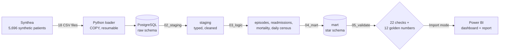
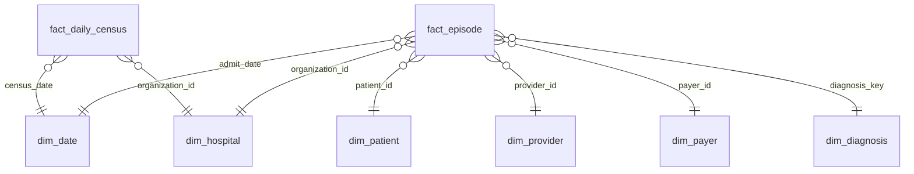

# Project Guide: Hospital Care Quality and Efficiency Analytics

The full write-up behind the [README](../README.md): every insight, the recommendations with their evidence, the methodology, and how to run the pipeline.

An end-to-end healthcare analytics project: synthetic patient records generated with **Synthea**, modelled in **PostgreSQL**, orchestrated with **Python**, and reported in **Power BI**. It answers one question a hospital leadership team cares about:

> **Where can we improve patient outcomes and use beds more efficiently, and what should we do first?**


---

## Headline results (admissions 2017 to 2025)

| Metric | Result | What it means |
|---|---|---|
| Episodes of care | **1,891** | Hospital stays, with same-day transfers and overlapping stays merged into one episode |
| 30-day unplanned readmission rate | **1.82%** (34 of 1,868 eligible episodes) | Planned lung cancer treatment cycles are excluded |
| In-hospital mortality | **1.22%** (23 deaths) | Deaths during the stay |
| Average length of stay | **5.54 days** (median 4.0) | A few long stays lift the average above the median |
| Average daily census | **3.18 patients** (peak 15) | Patients in a bed at midnight across the network |

**The short version:**
- **Cardiac care drives quality risk.** It accounts for 30 of the 34 readmissions and 12 of the 23 deaths.
- **Two groups drive bed use.** Substance use and lung cancer take 62% of all inpatient days.
- **Shorter stays did not cause the readmissions.** The only group with short stays and high readmission is Cardiac, so the fix is better discharge planning, not longer stays everywhere.

---

## Key insights

### 1. Cardiac care drives readmissions


- Cardiac episodes return within 30 days at **8.80%**, against 1.33% or less for every other group.
- That is **30 of the 34** unplanned readmissions, all at Fitchburg, the network's cardiac centre.
- The cardiac group covers heart failure, heart attack and bypass surgery, three of the six conditions in Medicare's [Hospital Readmissions Reduction Program](https://cms.hhs.gov/Medicare/Medicare-Fee-for-Service-Payment/AcuteInpatientPPS/Readmissions-Reduction-Program.html), which can cut payments by up to 3%.

### 2. Readmissions are low overall, with a 2021 spike


- **2021 had 8 readmissions (3.38%)**, double a typical year, during the second COVID-19 year. 2018 had none.
- With 0 to 8 readmissions a year, one patient moves a yearly rate by about 0.5 points, so counts are always shown next to rates.
- The overall 1.82% is far below the **13.9%** US average reported by [AHRQ (2016)](https://hcup-us.ahrq.gov/reports/statbriefs/sb248-Hospital-Readmissions-2010-2016.jsp). This is a limitation of the synthetic data (see [Limitations](#limitations)), not evidence of excellent care.
- By age, **65 to 74** has the highest readmission rate (3.05%).

### 3. Most readmissions happen after the first week


- Only **8 of 34** readmissions came within 7 days of discharge; the other 26 came in days 8 to 30, mostly in weeks 2 and 3.
- A follow-up visit within 7 days therefore happens *before* most returns, which supports early follow-up as an intervention.

### 4. Two diagnosis groups use 62% of inpatient days


- **Substance use**: **3,591** of the network's 10,474 inpatient days (489 episodes at 7.34 days on average, median 5).
- **Lung cancer**: **2,947** days (447 episodes at 6.59 days). Most of these are planned treatment cycles.
- Respiratory and COVID-19 stays are the longest, at **12.35 days** on average.

### 5. COVID-19 stretched hospital stays


- The average stay peaked at **7.13 days in 2020** and 6.28 in 2021, then returned to about 5 days from 2022.
- Bed demand is spiky: **3.18** patients in a bed on an average night, but **15** on the busiest night.

### 6. Short stays only hurt in Cardiac


- The longest-stay groups (substance use, lung cancer, respiratory) have readmission rates near zero.
- **Cardiac is the exception**: among the shortest stays (3.38 days) but by far the highest readmission rate.

### 7. Where deaths happen


- **Cardiac has the most deaths**: 12 of 23 (3.40% of cardiac episodes).
- **Respiratory and COVID-19 has the highest death rate**: 9.68% (9 of 93 episodes), with the longest stays (12.35 days).

---

## Recommendations

Each recommendation names an action, a measure to track, and the published evidence behind it.

| # | Recommendation | Measure / target | Evidence |
|---|---|---|---|
| 1 | **Structured discharge for every cardiac patient**: a written after-care plan plus a pharmacist phone call 2 to 4 days after discharge | Cardiac readmission rate from 8.80% to about 6.2% | Project RED cut 30-day return visits by 30% ([Jack et al., *Annals of Internal Medicine*, 2009](https://www.sciencedaily.com/releases/2009/02/090202174836.htm)) |
| 2 | **Book a clinic visit within 7 days before the patient leaves** | % of cardiac discharges with a 7-day visit booked | Hospitals with more early follow-up had 9 to 15% fewer heart failure readmissions ([Hernandez et al., *JAMA*, 2010](https://www.mdedge.com/content/follow-lowers-30-day-chf-readmissions)). Here, 26 of 34 returns happen after day 7. |
| 3 | **Refer every heart attack and bypass patient to cardiac rehabilitation** | Referral rate at discharge | 25% fewer readmissions and 42% lower mortality ([Dunlay et al., *American Journal of Medicine*, 2014](https://scholarlycommons.libraryinfo.bhs.org/all_works/7657)) |
| 4 | **Use home visits or a heart failure clinic**, not telemonitoring or leaflets alone | Heart failure readmissions | A review of 47 trials found home visits and clinics work and telemonitoring does not ([Feltner et al., *Annals of Internal Medicine*, 2014](https://www.healthday.com/healthpro-news/cardiovascular-diseases/transitional-care-interventions-up-heart-failure-outcomes-688121.html)) |
| 5 | **Do not shorten cardiac stays further**; fix the discharge process first | Cardiac length of stay held at the current level | US heart failure stays fell from 8.8 to 6.3 days while readmissions rose from 17.2% to 20.1% ([Bueno et al., *JAMA*, 2010](https://sciencedaily.com/releases/2010/06/100601162240.htm)) |
| 6 | **Audit substance use stays**: split each stay into days of clinical need and days waiting for placement, and add an addiction consult team | Waiting days per stay; readmission rate as a guardrail | Addiction consults were linked to 16.7% vs 20.4% readmission ([Lambert et al., *J Gen Intern Med*, 2025](https://www.the-hospitalist.org/hospitalist/article/39044/addiction-medicine/addiction-consultation-and-medications-for-substance-use-disorders-associated-with-reduced-30-day-readmission-rates/)) and raised follow-up treatment from 23% to 39% ([Englander et al., 2019](https://www.chcs.org/resource-center-item/inpatient-addiction-medicine-consultation-and-post-hospital-substance-use-disorder-treatment-engagement-a-propensity-matched-analysis/)) |
| 7 | **Pilot day-case care for suitable lung cancer cycles** | Each cycle moved frees about 5.6 bed days | An inpatient-to-outpatient regimen switch saved about $15,000 per patient ([Cotter et al., ONS, 2016](https://www.onclive.com/view/moving-time-consuming-chemotherapy-regimens-from-inpatient-to-outpatient-settings-improves-quality-of-life-and-saves-money-study-shows); a leukemia regimen, so a direction to test) |
| 8 | **Staff for normal nights, plan for surges** | Staffed beds at least average census ÷ 0.85 per hospital, plus a surge plan for nights near the peak of 15 | Bed shortages start above 85% occupancy ([Bagust et al., *BMJ*, 1999](https://pubmed.ncbi.nlm.nih.gov/10406748)) |
| 9 | **Run a clinical review of cardiac care** | Review the 12 cardiac deaths and 30 cardiac readmissions | Standard clinical governance practice |

---

## Architecture



| Layer | What happens | Key techniques |
|---|---|---|
| **Generate** | Synthea creates 5,696 patients (seed 2026, Massachusetts) | Java CLI driven from Python |
| **Load** | 18 CSV files (12.8M rows) into `raw` | PostgreSQL `COPY`, resumable state file, continues past failures |
| **Stage** | Typed tables, UTC dates, diagnosis groups, payer categories | Type casting, `REGEXP_REPLACE` name clean-up |
| **Logic** | Episodes of care, 30-day readmissions, mortality, daily census | Gaps-and-islands, `LEAD()` window function, `generate_series` |
| **Mart** | Star schema: 2 fact tables, 6 dimensions | Surrogate keys, foreign keys, analysis window table |
| **Validate** | 22 reconciliation, logic and integrity checks; 12 golden numbers | `DO` block that fails the build on any error |
| **Report** | One-screen dashboard + 3 report pages + About page | DAX measures, synced slicers, page navigation, custom theme |

### Data model



---

## Metric definitions

| Term | Definition |
|---|---|
| **Episode of care** | One hospital stay. Same-day returns and overlapping stays (transfers, staged procedures) are merged into one episode. |
| **Index episode** | An episode that can be followed for readmission: discharged alive, with 30 days of data after discharge. |
| **Unplanned readmission** | The patient's next episode starts 1 to 30 days after discharge and is not a planned lung cancer treatment cycle. |
| **Length of stay** | Calendar days from admission to discharge, minimum 1 day. |
| **Daily census** | Patients in a bed at midnight. Used instead of bed occupancy, because the data has no bed counts. |

**Why the readmission definition matters.** In the exploratory analysis (all years, before the 2017 to 2025 window), the same data gave very different answers depending on the rule:

| Definition | Rate |
|---|---|
| Any return within 30 days | 15.5% |
| Excluding same-day transfers and overlapping stays | 10.8% |
| **Also excluding planned lung cancer cycles (used here)** | **1.6%** |
| Only returns for a different reason | 0.8% |

A cluster of 1,200 returns at days 28 to 35 turned out to be scheduled lung cancer treatment (99.6% same reason, same hospital). Counting those would make the hospital look as if it were failing patients when it was following a treatment plan.

---

## Power BI report

| Page | Contents |
|---|---|
| **Dashboard** | 5 KPI cards, readmissions by year, average stay by year, stay vs readmission by diagnosis group, diagnosis scorecard with readmission counts |
| **Readmissions** | Readmissions by diagnosis group (table with totals), when readmissions happen (days after discharge), rate by age group, with insights and recommendations |
| **Length of Stay** | Average and median stay by diagnosis group, inpatient days by diagnosis group, bed use by hospital (with network totals), with insights and recommendations |
| **Care vs Efficiency** | Stay vs readmission by diagnosis group, in-hospital deaths by diagnosis group (table with totals), median cost, with insights and recommendations |
| **About the data** | Definitions, measures, data limitations and sources |

All pages share a sidebar with page navigation and five synced filters: year, hospital, diagnosis group, payer category and age group.

<!-- Add screenshots of each page to screenshots/ and uncomment:


-->

---

## Repository structure

```
healthcare-analytics/
├── data/
│   └── synthea_csv/            # generated CSVs (not committed)
├── docs/
│   ├── images/                 # README charts
│   └── screenshots/            # Power BI screenshots
├── logs/                       # loader and SQL run logs (not committed)
├── notebooks/
│   └── 01_exploratory_data_analysis.ipynb
├── powerbi/
│   ├── hospital_dashboard.pbix
│   ├── hospital_theme.json
│   └── dax_measures.md
├── python/
│   ├── config.py               # reads .env, builds the database connection
│   ├── 01_generate.py          # runs Synthea, moves CSVs into data/
│   ├── 02_load_raw.py          # loads all 18 CSVs into raw (resumable)
│   └── 03_run_sql.py           # runs the SQL pipeline in order, checks golden numbers
├── sql/
│   ├── 00_setup/               # schemas
│   ├── 02_staging/             # patients, inpatient stays, conditions, organizations
│   ├── 03_logic/               # length of stay, readmissions, mortality, daily census
│   ├── 04_mart/                # dimensions and facts
│   └── 05_validate/            # 22 validation checks
├── tools/
│   └── synthea/                # synthea-with-dependencies.jar (not committed)
├── .env.example
├── requirements.txt
└── README.md
```

---

## How to run it

**Prerequisites:** Python 3.10+, PostgreSQL 15+, Java 17+ (for Synthea), Power BI Desktop.

```bash
# 1. Install Python packages
pip install -r requirements.txt

# 2. Configure the database connection
cp .env.example .env          # then edit host, port, user, password

# 3. Generate the synthetic data (about 5,700 patients)
python python/01_generate.py

# 4. Load all 18 CSV files into PostgreSQL (safe to re-run; resumes where it stopped)
python python/02_load_raw.py

# 5. Build staging, logic, mart and run the validation checks
python python/03_run_sql.py
```

Useful options:

```bash
python python/02_load_raw.py --only patients encounters   # reload specific tables
python python/03_run_sql.py --from 03_logic               # restart from a step after a fix
```

Then open `powerbi/hospital_dashboard.pbix` and click **Refresh**.

**Expected golden numbers** (the run stops if any differ): 1,891 episodes, 1,868 index episodes, 34 unplanned readmissions, 23 in-hospital deaths, 10,460 census bed-days.

---

## Limitations

- **Synthetic data.** Synthea models scheduled care well but generates few unexpected returns, so readmission rates are much lower than in real hospitals (1.82% here vs about 14% nationally).
- **Small numbers.** 34 readmissions and 23 deaths over nine years. Rates for a single year or hospital swing easily, so counts are shown next to rates and small hospitals are grouped as "Other hospitals".
- **Case mix.** The cardiac centre (Fitchburg) treats almost only cardiac patients, so its raw rates are not comparable with general hospitals without risk adjustment.
- **No bed counts.** Daily census is used instead of bed occupancy percentage.
- **Static insights.** The written insights describe all years and all hospitals; they do not change with the report filters. Every number in them can be found on the same report page.

---

## Skills demonstrated

- **SQL:** CTEs, window functions (`LEAD`, `DENSE_RANK`), gaps-and-islands, `generate_series`, star schema design, data validation
- **Python:** pipeline orchestration, PostgreSQL `COPY` loading, resumable jobs, SQL runner with checks, EDA in Jupyter
- **Power BI:** star schema relationships, DAX measures, custom theme, page navigation, synced slicers, report design
- **Healthcare analytics:** readmission methodology, episode construction, census metrics, evidence-based recommendations

---

## Sources

- Jack B. et al. (2009). A reengineered hospital discharge program to decrease rehospitalization. *Annals of Internal Medicine.* [Summary](https://www.sciencedaily.com/releases/2009/02/090202174836.htm)
- Hernandez A. et al. (2010). Early physician follow-up and 30-day readmission among Medicare heart failure patients. *JAMA* 303:1716-22. [Summary](https://www.mdedge.com/content/follow-lowers-30-day-chf-readmissions)
- Dunlay S. et al. (2014). Participation in cardiac rehabilitation, readmissions, and death after acute myocardial infarction. *American Journal of Medicine* 127(6):538-46. [Abstract](https://scholarlycommons.libraryinfo.bhs.org/all_works/7657)
- Feltner C. et al. (2014). Transitional care interventions to prevent readmissions for people with heart failure. *Annals of Internal Medicine.* [Summary](https://www.healthday.com/healthpro-news/cardiovascular-diseases/transitional-care-interventions-up-heart-failure-outcomes-688121.html)
- Bueno H. et al. (2010). Trends in length of stay and short-term outcomes among Medicare patients hospitalized for heart failure, 1993-2006. *JAMA.* [Summary](https://sciencedaily.com/releases/2010/06/100601162240.htm)
- Lambert E. et al. (2025). Addiction consultation and medication for opioid or alcohol use disorder and hospital readmission. *J Gen Intern Med.* [Summary](https://www.the-hospitalist.org/hospitalist/article/39044/addiction-medicine/addiction-consultation-and-medications-for-substance-use-disorders-associated-with-reduced-30-day-readmission-rates/)
- Englander H. et al. (2019). Inpatient addiction medicine consultation and post-hospital treatment engagement. *J Gen Intern Med.* [Summary](https://www.chcs.org/resource-center-item/inpatient-addiction-medicine-consultation-and-post-hospital-substance-use-disorder-treatment-engagement-a-propensity-matched-analysis/)
- Cotter J. et al. (2016). Moving out: transitioning an inpatient chemotherapy regimen to the outpatient setting. Oncology Nursing Society Congress. [Summary](https://www.onclive.com/view/moving-time-consuming-chemotherapy-regimens-from-inpatient-to-outpatient-settings-improves-quality-of-life-and-saves-money-study-shows)
- Bagust A., Place M., Posnett J. (1999). Dynamics of bed use in accommodating emergency admissions. *BMJ.* [PubMed](https://pubmed.ncbi.nlm.nih.gov/10406748)
- Centers for Medicare & Medicaid Services. [Hospital Readmissions Reduction Program](https://cms.hhs.gov/Medicare/Medicare-Fee-for-Service-Payment/AcuteInpatientPPS/Readmissions-Reduction-Program.html)
- AHRQ HCUP Statistical Brief 248. [Overview of clinical conditions with frequent and costly hospital readmissions, 2010-2016](https://hcup-us.ahrq.gov/reports/statbriefs/sb248-Hospital-Readmissions-2010-2016.jsp)
- Synthea synthetic patient generator. [synthetichealth.github.io/synthea](https://synthetichealth.github.io/synthea/)

---

*All patient data in this project is synthetic. No real patient information is used.*
