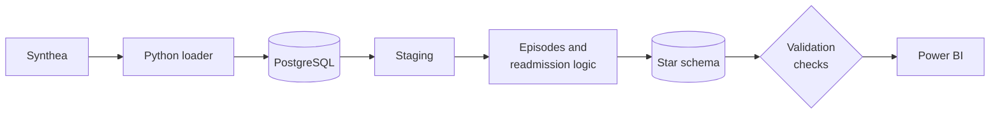

# Hospital Care Quality and Efficiency Analytics

An end-to-end healthcare analytics project: **Synthea** synthetic patient data, modelled in **PostgreSQL**, orchestrated with **Python**, and reported in **Power BI**.

**Business question:** where can a hospital network improve patient outcomes and use beds more efficiently, and what should it do first?


## Headline results (admissions 2017 to 2025)

| Episodes of care | Readmission rate | In-hospital mortality | Average stay | Average daily census |
|:---:|:---:|:---:|:---:|:---:|
| **1,891** | **1.82%** | **1.22%** | **5.54 days** | **3.18 patients** |

## Key findings

**1. Cardiac care drives readmissions.** Cardiac episodes return within 30 days at 8.80%, against 1.33% or less for every other group. That is 30 of the 34 readmissions.


**2. Two groups use 62% of inpatient days.** Substance use (3,591 days) and lung cancer (2,947 days) out of 10,474 are where bed-day savings would come from.

**3. Shorter stays are not the problem, except in Cardiac.** The longest-stay groups have readmission rates near zero. Cardiac alone combines short stays (3.38 days) with high readmission, so the fix is better discharge planning, not longer stays.

## Top recommendations

1. **Structured discharge for cardiac patients**: an after-care plan plus a pharmacist call 2 to 4 days after discharge. This approach cut return visits by 30% in the Project RED trial.
2. **A clinic visit within 7 days of discharge.** Only 8 of 34 readmissions happen in the first week, so the visit comes before most returns.
3. **Audit substance use stays** to separate days of clinical need from days waiting for placement.

All findings, recommendations with sources, and methodology are in the **[Project Guide](docs/PROJECT_GUIDE.md)**.

## How it works



| Tool | Used for |
|---|---|
| **Python** | Generating data, loading 12.8M rows, running the SQL pipeline with checks |
| **PostgreSQL** | Cleaning, episode and readmission logic (window functions, gaps-and-islands), star schema |
| **Power BI** | DAX measures, one-screen dashboard, three report pages with insights |

## Quick start

```bash
pip install -r requirements.txt
cp .env.example .env              # add your PostgreSQL connection
python python/01_generate.py      # create synthetic patients
python python/02_load_raw.py      # load into PostgreSQL
python python/03_run_sql.py       # build and validate the model
```

Then open `powerbi/hospital_dashboard.pbix` and click **Refresh**. Prerequisites and options are in the [Project Guide](docs/PROJECT_GUIDE.md#how-to-run-it).

---

*All patient data is synthetic (Synthea). No real patient information is used.*
